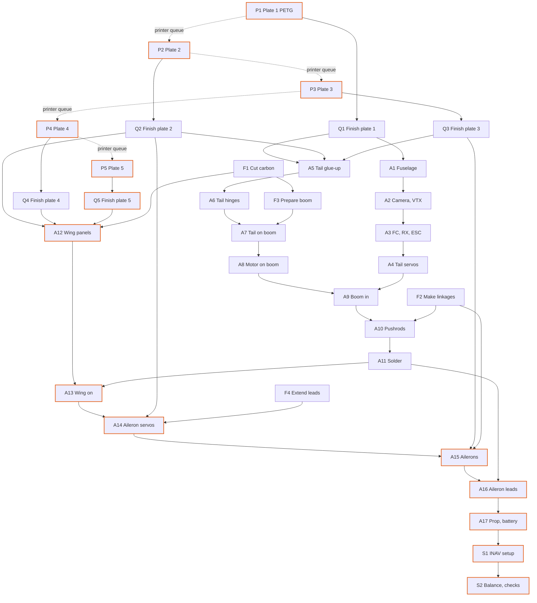

# Kipinä, single boom: bill of process

Generated by `process.py` from the CAD model and the slicer. Do not edit by hand.

One builder and one Bambu Lab A1 mini. Print times come from PrusaSlicer 2.7, A1-mini-like profile (tools/a1mini.ini); hand times are Boothroyd-Dewhurst handling and insertion estimates plus shop times for gluing, soldering and bending (see `process.py`).

| | |
|---|---|
| Printer time | 9 h 53 min over 5 plates, 100 g of filament |
| Hands-on time | 2 h 01 min (prep, assembly, setup) |
| Epoxy cure waits | 1 h 15 min |
| Lead time | **11 h 26 min** with the builder working while the printer runs |
| Critical path | P1 > P2 > P3 > P4 > P5 > Q5 > A12 > A13 > A14 > A15 > A16 > A17 > S1 > S2 |

## Precedence graph

Solid arrows: must finish first. Dashed: the printer queue. Highlighted: critical path.

## Operations

| op | operation | station | resource | time | start | end | needs | tools / consumables |
|---|---|---|---|---|---|---|---|---|
| P1 | Print plate 1: fuselage halves, lid, tail mount, rudder, motor mount | Print | printer | 2 h 58 min | 0 min | 2 h 58 min | - |  |
| F1 | Cut the boom and the wing spars | Prep | builder | 2 min | 0 min | 2 min | - | rotary tool or fine saw, ruler, file |
| F2 | Make the pushrods and aileron links | Prep | builder | 7 min | 2 min | 9 min | - | wire bender or pliers, cutter, heat gun, CA, heat-shrink |
| F3 | Drill the pushrod exits and the motor-wire entry, thread the PTFE sleeves and motor wires through the boom | Prep | builder | 7 min | 9 min | 16 min | F1 | 2 mm and 3.2 mm drills in a pin vice, ruler, PTFE tube 2/1 mm, silicone wire (motor, about 370 mm x 3) |
| F4 | Extend both aileron servo leads by about 55 mm, cut off their plugs | Prep | builder | 5 min | 16 min | 21 min | - | soldering iron, wire stripper, 3-core servo wire, solder, heat-shrink |
| P2 | Print plate 2: wing centre, fin, aileron fairings | Print | printer | 2 h 29 min | 2 h 58 min | 5 h 31 min | - |  |
| Q1 | Finish plate 1 parts, ream the boom socket and motor cap | Prep | builder | 2 min | 2 h 58 min | 3 h 00 min | P1 | 10.2 mm drill or round file |
| A1 | Glue the fuselage halves together | Fuselage | builder | 0 min | 3 h 00 min | 3 h 00 min | Q1 | CA |
| A2 | Fit the camera and VTX in the nose | Fuselage | builder | 1 min | 3 h 00 min | 3 h 01 min | A1 | CA, foam tape |
| A3 | Screw the FC on its posts, add the receiver, lay the ESC under the boom's mouth | Fuselage | builder | 1 min | 3 h 01 min | 3 h 02 min | A2 | 1.5 mm hex driver, foam tape |
| A4 | Screw the elevator and rudder servos to their posts behind the battery | Fuselage | builder | 1 min | 3 h 02 min | 3 h 03 min | A3 | small Phillips driver |
| P3 | Print plate 3: stabiliser, elevator, ailerons | Print | printer | 1 h 28 min | 5 h 31 min | 6 h 59 min | - |  |
| Q2 | Finish the wing centre, fin and fairings, ream the spar holes | Prep | builder | 4 min | 5 h 31 min | 5 h 35 min | P2 | 3.2 / 2.2 mm drill bits |
| P4 | Print plate 4: right wing panel | Print | printer | 1 h 29 min | 6 h 59 min | 8 h 29 min | - |  |
| Q3 | Finish the tail surfaces and ailerons | Prep | builder | 1 min | 6 h 59 min | 7 h 01 min | P3 |  |
| A5 | Glue the stabiliser under the tail mount's pylons and the fin into its socket | Tail | builder | 1 min | 7 h 01 min | 7 h 02 min | Q1, Q2, Q3 | CA |
| A6 | Hinge the elevator and the rudder | Tail | builder | 2 min | 7 h 02 min | 7 h 03 min | A5 | hinge tape |
| A7 | Slide the tail onto the boom, square it and glue | Boom | builder | 3 min + 15 min cure | 7 h 03 min | 7 h 06 min | A6, F3 | 5-minute epoxy |
| A8 | Glue the motor cap on the boom's end, screw on the motor, solder its wires | Boom | builder | 4 min + 15 min cure | 7 h 21 min | 7 h 25 min | A7 | 1.5 mm hex driver, soldering iron, 5-minute epoxy, solder, heat-shrink |
| A9 | Push the boom into the fuselage socket, square the tail to the fuselage and glue | Frame | builder | 3 min + 15 min cure | 7 h 40 min | 7 h 43 min | A8, A4 | 5-minute epoxy |
| A10 | Run the elevator and rudder pushrods through their sleeves, hook up both ends | Frame | builder | 1 min | 7 h 58 min | 7 h 59 min | A9, F2 |  |
| A11 | Solder the tail servos, ESC, power, video and receiver wiring | Fuselage | builder | 15 min | 7 h 59 min | 8 h 14 min | A10 | soldering iron, solder, heat-shrink, silicone wire |
| P5 | Print plate 5: left wing panel | Print | printer | 1 h 29 min | 8 h 29 min | 9 h 58 min | - |  |
| Q4 | Remove the brim from the right panel, ream spar holes | Prep | builder | 2 min | 8 h 29 min | 8 h 30 min | P4 |  |
| Q5 | Remove the brim from the left panel, ream spar holes | Prep | builder | 2 min | 9 h 58 min | 10 h 00 min | P5 |  |
| A12 | Slide in the spars and glue on both wing panels | Wing | builder | 2 min + 15 min cure | 10 h 00 min | 10 h 02 min | Q2, Q4, Q5, F1 | 5-minute epoxy |
| A13 | Glue the wing onto the fuselage's flat top | Frame | builder | 3 min + 15 min cure | 10 h 17 min | 10 h 20 min | A12, A11 | 5-minute epoxy |
| A14 | Fit the aileron servos, thread their leads through the wing centre into the fuselage, glue the fairings over them | Wing | builder | 3 min | 10 h 35 min | 10 h 37 min | A13, Q2, F4 | hot glue, CA |
| A15 | Hinge the ailerons, glue the horns, fit the links | Wing | builder | 3 min | 10 h 37 min | 10 h 40 min | A14, Q3, F2 | hinge tape, CA |
| A16 | Solder the aileron leads to the FC and tidy the wiring | Final | builder | 5 min | 10 h 40 min | 10 h 45 min | A15, A11 | soldering iron, solder, heat-shrink |
| A17 | Fit the prop, battery, antenna and lid | Final | builder | 1 min | 10 h 45 min | 10 h 46 min | A16 | prop wrench |
| S1 | Bind the receiver and set up INAV | Setup | builder | 32 min | 10 h 46 min | 11 h 18 min | A17 | laptop with INAV Configurator |
| S2 | Balance and run the pre-flight checks | Setup | builder | 8 min | 11 h 18 min | 11 h 26 min | S1 | CG balancer or fingertips |

## Parts per operation

- **P1** fuselage_front, fuselage_rear, lid, tail_mount, rudder, motor_mount
- **P2** wing_centre, fin, fairing_ail_R, fairing_ail_L
- **P3** stab, elevator, aileron_R, aileron_L
- **P4** wing_R
- **P5** wing_L
- **A1** fuselage_front, fuselage_rear
- **A2** camera, vtx
- **A3** fc, M2 screw (FC), receiver, esc
- **A4** servo_elev, servo_rud, servo screw
- **A5** tail_mount, stab, fin
- **A6** elevator, rudder
- **A7** boom, tail sub-assembly
- **A8** motor_mount, motor, M2 screw (motor)
- **A9** boom sub-assembly
- **A10** pushrod_elev, pushrod_rud
- **A12** wing_centre, spar_main, spar_rear, wing_R, wing_L
- **A13** wing sub-assembly
- **A14** servo_ail_R, servo_ail_L, fairing_ail_R, fairing_ail_L
- **A15** aileron_R, aileron_L, horn_ail_R, horn_ail_L, pushrod_ail_R, pushrod_ail_L
- **A17** prop, battery, antenna, lid
