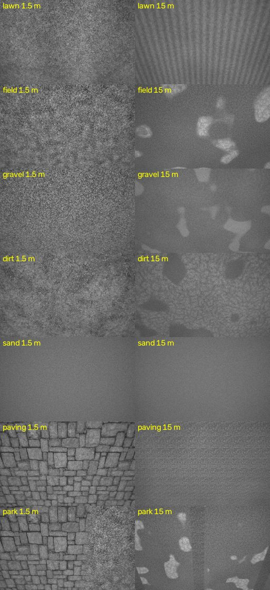

# VIO from a downward camera: what tilt, rotation, field of view, speed, height and the ground do

**Two studies.** The first (below "First") flies over navcore's procedural IR
texture. The second -- **"Over real ground"**, at the end -- repeats the core
of it over real ground photographs under the sun, and is the one to trust
for what texture does: it finds the failure the procedural texture hides
(featureless ground) and a speed limit set by texture scale.

Measured 2026-10-25 with `nav-sim/test/downvio_sweep` (grid: `downvio_sweep.sh`,
raw: `downward_vio_sweep.csv`, 344 runs). The estimator is the aircraft's own
**DepthVio** (navcore/vio.hpp), unchanged except for the fix below; the
camera looks straight down from the airframe (image top = nose) and is
rendered every frame at the TRUE body attitude through navcore's IR model.
The IMU gives the VIO that attitude with 0.3 deg of noise. 640x400 global
shutter, 30 fps unless stated, 4 seeds per condition, numbers are mean drift
(final horizontal error as % of distance) +- standard error.

Two depth sources:

- **mono + rangefinder** ("plane"): a wide-angle global-shutter camera and a
  downward rangefinder. Per-pixel range from the rangefinder, the IMU's
  attitude and a flat-ground assumption -- the cheap downward option.
- **downward stereo**: a second D435-class depth camera (navcore's stereo
  failure model).

## First: DepthVio could not do this at all

DepthVio held the attitude as Euler angles. A downward camera is at pitch -90,
that representation's gimbal lock, and 0.3 deg of IMU noise swung the yaw/roll
split by tens of degrees per frame: **102 % drift** on a level 6 m flight
(test_vio, with its 0.5 deg/s gyro bias), every pose reported valid. Fixed by
composing the IMU attitude as a matrix (commit "DepthVio: attitude as a
matrix"); the forward camera is unchanged in effect (test_vio at 848x480: same
to the centimetre in all 12 cases). Everything below is with the fix.

## Tilt: does not matter (flat ground, attitude known)

2 m/s, 1.5 m up. Drift %, mono + rangefinder / stereo:

| tilt | 60 deg lens | 90 deg | 120 deg | 140 deg |
|---|---|---|---|---|
| 0 | 0.34 / 0.42 | 0.44 / 0.40 | 0.40 / 0.46 | 0.52 / 1.09 |
| 20 | 0.25 / 0.47 | 0.89 / 0.49 | 0.37 / 0.57 | 0.53 / 0.94 |
| 40 | 0.53 / 0.85 | 0.29 / 0.19 | 0.76 / 0.59 | 0.61 / 0.96 |

No lost frames anywhere in the table. A nose-down quad's belly camera looks
BACKWARD; at 40 deg a 140 deg lens has the horizon in view (80 % floor) and
still holds. (The wide stereo is ~1 %: its depth is less precise per pixel.)

## Rotation rate: does not matter

Roll/pitch wobble at 1.5 Hz on a 15 deg tilt: peak 94 and 188 deg/s give
0.46-0.82 % at every lens. DepthVio takes rotation from the IMU and solves
only heading and position, so rotation is not something it has to see.

## FPV cruise: fine at 60 fps

5 m up, tilt and speed together (10 deg/5 m/s ... 40 deg/18 m/s): 0.33-1.00 %
at every lens, no lost frames. At 30 fps the same speeds need the per-frame
jump gate raised (kestrel's 0.5 m is set for its slow legs).

## What DOES matter

**1. Attitude accuracy -- for mono + rangefinder only.** A constant roll/pitch
bias (level flight):

| bias | mono 60 deg | mono 140 deg | stereo 60 deg | stereo 140 deg |
|---|---|---|---|---|
| 0.5 deg | 5.1 % | 3.6 % | 0.22 % | 1.02 % |
| 1 deg | 10.4 % | 5.9 % | 0.44 % | 0.91 % |
| 2 deg | 20.9 % | 10.3 % | 0.45 % | 0.72 % |

Linear, ~10 % per degree at 60 deg, ~6 % at 140 deg (standard errors
0.1-0.4). Stereo does not care. The mono setup builds its depth FROM the
attitude, so an attitude error is a tilted ground plane, and DepthVio's
keyframe odometry turns it into drift. An EKF's tilt is good to a few tenths
of a degree in steady flight and worse when accelerating, so through DepthVio
this is the error that will dominate. A flow estimator that takes gyro RATES
(ArduPilot's own optical-flow fusion) is far less exposed to it; so would be
estimating the ground plane from the image rather than from the IMU.

**2. Ground that is not flat -- mono + rangefinder.** Boxes 0.3-1.5 m tall
over 15 % of the floor: mono 4.0-10.3 % (worst: 140 deg lens at 30 deg tilt,
which sees the most of it obliquely), stereo 0.95-2.8 %. Flat-ground depth is
wrong exactly where the ground is not flat.

**3. Height -- for a wide lens.** 20 deg tilt, 4 m/s:

| height | 60 deg | 140 deg |
|---|---|---|
| 1.5 m | 0.79 % | 0.56 % |
| 5 m | 0.33 % | 0.52 % |
| 15 m | 0.74 % | **10.4 %** |

A 140 deg lens spreads 640 px over 140 deg: from 15 m that is ~5 cm of ground
per pixel at the centre and far worse at the oblique edge, where flat-ground
depth is also least certain. Wide is right low, narrow is right high.

Low texture (smooth concrete, richness 0.15) changed nothing here -- but the
IR model is band-limited value noise with structure at every scale, kinder
than real smooth floors; do not read that row as a guarantee.

## Not modelled

Pinhole lenses only (real >120 deg lenses are fisheye: better centre, worse
edges than this); no motion blur, rolling shutter, exposure changes or
vibration; IMU error as white noise plus a constant bias; straight lines of
20-60 m; one texture model; 4 seeds per condition.

## Over real ground

The procedural texture has structure at every scale by construction, so it
cannot show a ground that runs out of features. `nav-sim/ground_texture.hpp`
renders what a downward daylight camera sees instead: real photographs
(lawn, grass, gravel, cracked dirt, rocky ground, sand, paving;
`nav-sim/textures/fetch_ground_textures.sh` pins them -- three.js,
Babylon.js and scikit-image, with their licences) at physical size, by
stochastic tiling (no lattice at any height), laid out as scenes with patches
and large-scale brightness variation, mipmapped by pixel footprint, lit by a
sun with object shadows and optionally the aircraft's own shadow, through a
camera with auto-exposure, vignetting, noise and motion blur.

Mono + rangefinder, 20 deg tilt, 4 m/s, 4 seeds per cell, drift % (raw:
`downward_vio_ground.csv`; grid: `test/downvio_ground.sh`):

| ground | 1.5 m, 60 deg | 1.5 m, 120 deg | 5 m, 60 deg | 5 m, 120 deg | 15 m, 60 deg | 15 m, 120 deg |
|---|---|---|---|---|---|---|
| procedural (old) | 0.52 | 0.63 | 0.29 | 0.18 | 0.99 | 2.30 |
| lawn | 0.64 | 0.44 | 0.28 | 0.28 | 0.78 | 4.40 |
| field | 0.48 | 0.52 | 0.21 | 0.29 | 0.82 | 2.04 |
| gravel | 0.75 | 0.89 | 0.29 | 0.38 | 0.91 | 2.73 |
| dirt | 0.69 | 0.36 | 0.42 | 0.35 | 0.87 | 1.99 |
| paving | 0.40 | 0.28 | 1.21 | 0.35 | 1.16 | 1.25 |
| park | 0.70 | 0.32 | 0.72 | 0.25 | 1.22 | 2.55 |
| **sand** | 7.0 (7 % lost) | 0.71 | **78 (71 % lost)** | **100 lost** | **100 lost** | **100 lost** |

- **Real grass, gravel, dirt and paving track as well as the procedural
  texture** -- within a factor of ~2 everywhere, under 1 % up to 5 m. The old
  study's conclusions about tilt, rotation and attitude bias stand.
- **Sand is the failure the procedural texture hid.** Its grain is a
  millimetre: from 5 m a pixel spans centimetres and the ground is grey. No
  corners, no track, at any lens. (One seed of four also lost 26 % at 1.5 m
  with the narrow lens.) An untrodden sand plain, snow, still water and fresh
  concrete belong in this class; real beaches with tracks and ripples will be
  somewhat better -- this sand has only 5 % brightness variation at 15 m.
- **Height still favours the narrow lens**: at 15 m the 120 deg lens drifts
  2-4.4 %, the 60 deg 0.8-1.2 %, on every real ground.
- **Light does not matter here.** Sun at 20 or 70 deg: identical. The
  aircraft's own shadow in view (sun at 70 deg, 120 deg lens): field 0.49 ->
  0.66 %, paving 0.28 -> ~0.3 %, inliers down ~10 % -- the moving blob is voted
  out as an outlier, as it should be.
- **Motion blur does not matter here**: 12 m/s at 5 m, 60 fps, exposures 0 /
  2 / 6 ms (up to ~8 px of smear): 0.29-0.63 % with either lens.

### Fine texture sets a speed limit

Gravel's structure is all fine: at 1.5 m with the 60 deg lens it tracks at
4-6 m/s (0.4-0.8 %) and fails at 8 m/s (60-70 % drift, over half the frames
lost; ~99 px of image motion a frame at 30 fps), where paving's coarse slabs
still hold (0.6-0.8 %). The tracker's coarse pyramid levels need coarse
structure to catch large motion. Speed limit ~ (frame rate x height x texture
scale): fly higher, faster frames, or over coarser ground.

### A DepthVio change, and an honest account of it

While lost, DepthVio let its velocity decay and searched the next frame where
the floor would be had the aircraft stopped. It now searches with the last
MEASURED velocity for up to a second (`VioParams::reacquireFrames`); the
reported coast still decays. Over an EARLY version of these textures, which
still showed the photo's tile lattice, that turned a permanent loss into a
recovery (gravel seed 1: 28 % -> 1.1 %). Over the final textures it changes
little: equal in every case tried but one (gravel at 8 m/s: 70 -> 61 %).
Kept because it is right and never worse; not claimed as a measured win.
`ctest -R downvio_gravel_track` checks gravel at 4 m/s tracks (with the
photographs; skipped without).

### Caveats for this part

Grey visible-light luminance (a NIR camera sees vegetation much brighter);
the photographs' physical sizes are judged from their content; scenes are
flat (objects only in the cluttered world of the first study); 20-50 m
straight lines; 4 seeds.

## Can a wide lens replace the IMU's attitude?

`downvio_sweep --attitude vision` flies the downward camera with NO IMU: a
6-DOF visual odometry (PnpVo: DepthVio's front end, pose by PnP RANSAC + LM),
roll and pitch from the image. The mono + rangefinder ground plane is built
from the vision's OWN tilt. Against DepthVio on IMU attitude (0.3 deg noise,
and +1 / +2 deg bias). 1.5 m, 15 m paths, procedural texture, 4 seeds
(`test/downvio_noimu.sh`, raw: `downward_vio_noimu.csv`). Drift %, (tilt RMS):

| mono + rangefinder | 60 deg | 90 deg | 120 deg | 140 deg |
|---|---|---|---|---|
| level, IMU | 0.39 | 0.30 | 0.38 | 0.52 |
| level, IMU +1 deg | 7.9 | 6.3 | 4.8 | 4.6 |
| level, IMU +2 deg | 15.8 | 11.5 | 8.2 | 8.0 |
| level, **vision** | **0.23** (0.2) | **0.59** (0.9) | **0.26** (0.6) | **0.42** (0.6) |
| manoeuvre, IMU | 0.71 | 0.62 | 1.26 | 0.55 |
| manoeuvre, IMU +1 deg | 7.1 | 5.9 | 3.8 | 3.7 |
| manoeuvre, IMU +2 deg | 12.7 | 10.8 | 8.5 | 7.0 |
| manoeuvre, **vision** | **14.9 fails** (24, 11 % lost) | **0.60** (0.5) | **0.36** (1.4) | **0.50** (0.8) |

(manoeuvre: 15 deg tilt + 10 deg roll/pitch wobble at 1.5 Hz, peak 94 deg/s.)

- **Mono + rangefinder: yes, with a lens of 90 deg or more.** Vision-only
  attitude matches an accurate IMU and beats one off by 1-2 deg ten- to
  twentyfold: its tilt is consistent with the ground plane it builds, an IMU
  bias is not. A 60 deg lens fails once the aircraft manoeuvres.
- **Downward stereo: no -- keep the IMU.** Stereo ignores IMU bias (0.3-1.3 %
  at 2 deg); vision-only attitude there is worse (0.7-12.7 % level, 2.6-18.7 %
  manoeuvring, 2-28 deg tilt error): noisy depth lets PnP trade tilt for
  translation. Wider lenses help, not enough.
- Practical reading: use vision tilt to correct the IMU's bias, keep the IMU
  as the gravity reference for when the image fails (sand, snow, lost).

Not tested: uneven ground (vision attitude leans on the flat-ground plane),
other heights, real-ground photographs, a drifting rather than constant bias.
