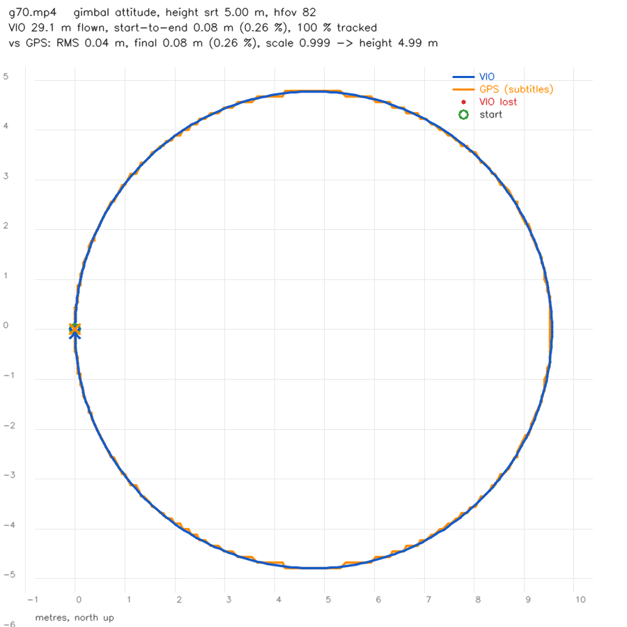

# Downward VIO on recorded footage (DJI Neo 2)

`footage_vio` (nav-sim/test/footage_vio.cpp) runs the estimators from the
[downward-camera study](downward_vio.md) on a video file, unchanged.

- **Input:** footage from a camera looking down at the ground: a DJI Neo 2 on
  its gimbal, or anything else.
- **Output:** the track, how far it ends from where it started, a fit against
  the GPS track in DJI's subtitles where there is one, and a picture.

The study answered how well this should work. This tool answers how well it
does work on a real camera, a real lens and a real compressed video stream.

```
footage_vio --video DJI_0042.MP4 --hfov 82 --height 5 --plot track.png --csv track.csv
```

## The height is yours to set

The depth model is the one the study recommends for a light aircraft:

- one camera, plus a known height;
- the ground assumed flat;
- each pixel's ray cut against that plane.

So the height above the ground is the one number everything scales with. The
recording does not carry it reliably, so the tool takes it from one of three
sources:

| source | flag | notes |
|---|---|---|
| a constant | `--height M` | You flew at a set height. This wins over everything else. |
| a log | `--height-csv FILE` | Rows of `time_s,height_m`, interpolated: for example an export from the flight log with the downward rangefinder's height. `--height-time-offset S` lines its clock up with the video. |
| the subtitles | (neither flag) | `rel_alt`. This is barometric, **relative to takeoff**. |

A Neo is often launched from the hand. `rel_alt` 0 is then the palm, about
1.2 m up, so add `--height-offset 1.2`. The offset applies to any of the
three sources.

**A wrong height scales the whole track.** 10% too high and every distance
comes out 10% long. A wrong lens does the same, since 10% too much focal
length is 10% too short.

When the subtitles have GPS, the report fits the track to it and says which
height would have made the scale exactly 1. On the synthetic test below, it
recovers 2.995 m from a run told 3.6 m.

**A closed loop does not show a scale error.** A wrong height stretches the
way out and the way back alike, and the loop still closes. Measured on the
synthetic loop, 20% wrong height still closed to 0.4%. To check the scale
without GPS, fly out to a **taped** mark and back. The report prints
"furthest from the start", to compare with the tape.

## The lens

- **`--hfov DEG`** is for a rectilinear video, one whose lines are already
  straight. DJI's normal video modes correct the distortion in the camera.
  Use the horizontal field of view of the video mode, which is not the
  photo's: modes crop differently.
- **`--calib FILE`** is better. Make one from a clip of a checkerboard:

  ```
  footage_vio --calibrate CHECKER.MP4 --board 9x6 [--fisheye] --out neo2.yml
  ```

  - `--board` counts the **inner** corners. A board on a laptop screen is
    fine: it is flat and sharp, and the square size (`--square-mm`) does not
    affect the lens.
  - Move it into every corner and edge of the frame, at several tilts. The
    distortion lives at the edges.
  - Shoot it **in the same video mode** as the flights. A different
    resolution or aspect is a different crop of the sensor. The tool warns
    if the aspect of the calibration and the video differ.
  - It reports the reprojection RMS and the corrected field of view. Above
    1 px, reshoot.

`--shot FILE.png` writes one processed frame, after lens correction, so you
can check that straight lines came out straight. Pixels the flat-ground depth
will not use (the sky, rays too oblique) are dimmed.

## Attitude

The study's question was whether tilt matters. On a gimbal it is answered
by construction: the gimbal holds the camera at a set pitch with a level
horizon, which is exactly what an IMU would hand the estimator.

| `--attitude` | estimator | tilt from |
|---|---|---|
| `gimbal` (default) | DepthVio, 4 DOF | `--gimbal-pitch` (−90 = straight down) and `--gimbal-roll` |
| `srt` | DepthVio, 4 DOF | `gb_pitch`, `gb_roll` and `gb_yaw` per frame from the subtitles, if the drone writes them |
| `vision` | PnpVo, 6 DOF | the image alone, after the first frame |

A video file has no gyro, so the yaw prior between frames comes from one of
two places:

- the VIO's own last turn rate, held constant;
- the subtitles' `gb_yaw`, with `--attitude srt`.

The prior is weighted as the guess it is (3°; 1° from the subtitles).
Heading at the start is `--start-yaw`, or `gb_yaw`, else 0. The comparison
with GPS fits one rotation about the start anyway.

## Subtitles

DJI writes subtitles (.SRT) beside the video when "Video Subtitles" is on in
DJI Fly. The tool reads them automatically when they share the video's name,
or with `--srt FILE`.

The fields differ by model and firmware, and **what a Neo 2 writes has not
been verified**. So every `name: number` pair is read by name, plus:

- the older layouts: `GPS(lon, lat, alt)` and `H 5.2m`;
- DJI's misspelling `longtitude`;
- 0,0 is treated as no fix.

The first line of output lists which of `latitude longitude rel_alt abs_alt
gb_pitch gb_roll gb_yaw` were found; a `(-)` marks one that is missing. The
original Neo had no GPS. If there is none, the start-to-end gap and a taped
distance are the checks.

## What to record

- **Camera:**
  - gimbal at −90°, then −70° and −45°;
  - EIS / RockSteady **off**, because it warps every frame by an unknown
    transform;
  - the highest frame rate the mode allows (`--every 2` brings 60 fps back
    to 30 if needed).
- **Heights:** 2 m, 5 m and 15 m.
- **Surfaces:**
  - grass;
  - gravel or asphalt;
  - one nearly featureless surface (smooth concrete, sand, snow), where it
    should fail.
- **The flight:**
  1. Hover 5 s over a marked spot.
  2. Fly a loop, slowly once and quickly once.
  3. Come back and hover 5 s over the **same** mark.
- **Scale:** tape out 20 m, fly from one mark to the other and back.
- **Lens:** the checkerboard clip, in the same video mode.
- **Subtitles** on. If the drone keeps a flight log, export its height too.

## Validated without a drone

`downvio_sweep` writes its rendered flights as footage, with the truth known:

- `--write-video FILE.mp4`: the frames;
- `--write-srt FILE.SRT`: DJI-layout subtitles with position, height and
  gimbal angles;
- `--gimbal DEG`: a stabilised camera, at a set pitch, that turns with the
  heading;
- `--path circle`: a loop that ends where it started.

`nav-sim/test/footage_vio_synthetic.sh` (ctest `footage_vio_synthetic`) runs
the whole chain on a 25 m loop at 3 m:

| run | flown | start to end | vs GPS (RMS / final) | implied height |
|---|---|---|---|---|
| height from subtitles (3.0 m) | 24.6 m | 0.08 m (0.31%) | 0.04 / 0.07 m | 2.99 m |
| custom `--height 3.6` (20% high) | 29.5 m | 0.10 m (0.34%) | 1.09 / 0.10 m | 2.995 m |

The second row is the warning above, measured: the track is 20% long, its
loop still closes, and only the GPS fit shows the error.

That test exercises the plumbing, not the camera:

- a video encode and decode;
- the subtitle layout;
- height and lens handling;
- the yaw stand-in on a continuously turning flight.

Real footage adds what no render has: rolling shutter, compression at
motion, lens vignetting and the camera's own processing.

### Through the video, at three gimbal angles

The same chain over the study's **real gravel** photographs. The setup:

- an 82° lens;
- 5 m height from the subtitles;
- a 30 m loop at 3 m/s, ending at its start;
- 960x540 mp4 at 30 fps;
- seed 1.

| gimbal | attitude | tracked | start to end | vs GPS RMS / final | implied height |
|---|---|---|---|---|---|
| −90° | gimbal | 100% | 0.25% | 0.04 / 0.07 m | 4.99 m |
| −90° | vision only | 100% | 0.22% | 0.04 / 0.07 m | 4.99 m |
| −70° | gimbal | 100% | 0.26% | 0.04 / 0.08 m | 4.99 m |
| −70° | vision only | 98% | **24.7%** | 2.32 / 4.76 m | 4.60 m |
| −45° | gimbal | 100% | 0.17% | 0.04 / 0.05 m | 5.00 m |
| −45° | vision only | 99% | **6.8%** | 0.54 / 1.91 m | 5.01 m |

`--attitude srt` gives the same numbers as `gimbal`, because the subtitles
carry the same fixed angle.

- **With the gimbal's angle, the angle does not matter.** Straight down or
  45° forward, the loop closes to a quarter of a percent.
- **Vision-only holds straight down and slips when oblique.** With the
  camera tipped forward, the image's horizontal motion can be explained
  partly as a tilt and partly as a translation, and the 6-DOF solve trades
  one for the other. The camera's pitch is the one thing a gimbal states
  outright, so give it, and use `--attitude vision` only to ask the
  question.

This is **one seed per row**: a check that the harness and the estimators
behave, not a measurement of the gap. The repository's rule for A/B claims
is at least four seeds per arm. The vision-only numbers in particular
should be read as "can fail", not as a rate.

Rendering took ~13 s/frame for 960x540 over the textured ground on this
machine. That is why there is one seed. The estimator itself ran at
10–13 ms/frame.



## What this cannot see

- **Rolling shutter.** The Neo 2's sensor reads out line by line, and fast
  motion skews the frame. The estimators assume a global shutter. Expect the
  fast passes to be worse than the slow ones, for this reason more than
  speed.
- **Ground that is not flat.** Anything standing up (trees, a car, the
  pilot) gets placed on the ground plane at the wrong range. The study
  measured 4–10% drift over clutter.
- **Sloping ground.** A height above takeoff is not a height above a hill.
